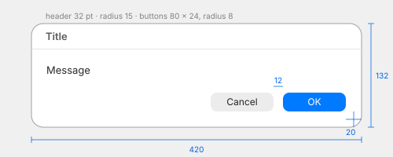

# Alerts

IDs: CT-AL-01, CT-AL-02, plus the alerts observed in the file manager (MU-32 and others).

## Modal alert with a header (CT-AL-01)

| Measure | Value |
| --- | --- |
| Size | 420 × 132 for a one-line message |
| Position | centred horizontally on the screen, in its upper half |
| Corner radius | ~15 pt (±2) |
| Header | 32 pt tall, then a 1 pt separator from edge to edge |
| Title | semibold, ~13 pt, left-aligned 18 pt from the edge |
| Message | ~13–14 pt, 19 pt from the left edge |
| Buttons | 80 × 24 visible, radius ~8, 12 pt apart, right-aligned 20 pt from the right and bottom edges |

| Colour | Light | Dark |
| --- | --- | --- |
| Background (opaque) | `#ffffff` | `#272727` |
| Outer border (1 pt) | black at ~25–40 % over the content | `#030303` |
| Inner edge light | — | `#3d3d3d` |
| Header separator | `#e5e5e5` | `#363636` |
| Title | `#595959` (dimmer than the message) | `#aaabab` |
| Message | `#272727` | `#dedede` |
| Default button | accent `#007aff`, white text, top and bottom rows 1 pt lighter | same |
| Cancel button | `#ececec`, text `#242424` | `#373737`, text `#e0e0e0` |

**Shadow:** below the border it starts at ~42 % opacity and fades over ~60 pt; on the right ~32 %
over ~48 pt; on the left ~35–40 pt; almost none on top. That puts the shadow about 10 pt lower than
the alert.

The appearance animation and the pressed / focused buttons were not captured.

## Alerts with an icon, suppression checkbox, three buttons (CT-AL-02, partial)

- **Warning style:** a card about 300 pt wide with the app icon at the top, a bold title, the
  message, a "don't ask again" checkbox, then the buttons **stacked full width** (default in the
  accent first, then the others, cancel last).
- **Critical style:** a yellow warning triangle with the app icon as a badge; buttons side by side.
- **Two-choice confirmation** (file manager, changing an extension): two buttons side by side,
  128 × 30 each, 6 pt apart.
- **Single OK** (name rejected): one full-width button.
- The dark secondary button gray varies between alerts (`#494949`–`#525253` observed); silica_ui's
  `SilicaAlert` uses `#525253` for all of them.
