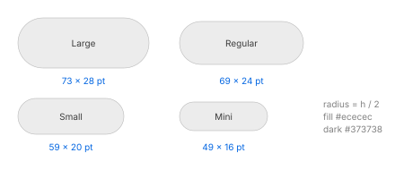

# Buttons

IDs: CT-BTN-01…19. State rules (no hover, one-step pressed fill, gray accent when inactive) are in
[focus-and-accent.md](focus-and-accent.md).

## Push buttons (CT-BTN-01, 02, 03)

Measured in a test gallery with a short label (seven characters):

| Size | Frame | Text |
| --- | --- | --- |
| Large | 73 × 28 | — |
| Regular | 69 × 24 | ~13 pt |
| Small | 59 × 20 | — |
| Mini | 49 × 16 | — |

- **Shape:** a full capsule (corner radius = half the height) in the gallery. Buttons inside alerts
  measure 80 × 24 visible with a radius of about 8 pt; see [alerts.md](alerts.md).
- **Normal:** fill `#ececec` light, `#373738` dark, no border; text `#242424` / `#e0e0e0`.
- **Default (Return):** accent fill (sRGB `#007aff`), white text, static: it does **not** pulse.
  The gallery default button with a two-letter label is 43 × 24. In alerts the top and bottom
  rows of the default button are 1 pt lighter (light `#3779fb`, dark `#296bed`, display values).
- **Destructive:** not observed in the gallery; silica_ui uses a pale red fill with red text
  (light `#fcccca` / `#ff383c`, dark `#734545` / `#f01d14`, *provisional*).
- Sizes mini and large have *provisional* corner radii in silica_ui (5 / 10) and label paddings.

## Bevel and square buttons (CT-BTN-04)

| Style | Frame | Light | Dark |
| --- | --- | --- | --- |
| Bevel (regular square) | 90 × 32 | rounded rectangle, gray fill as a push button | same |
| Small square | 90 × 24 (22 visible) | `#f8f8f8` with a 1 pt gray border; pressed `#bbbbbb` | `#454545` |

The bevel corner radius was not measured; silica_ui uses 4 pt (*provisional*).

## Help button (CT-BTN-05)

A 24 pt gray circle with a question mark, same fills and pressed rule as a push button.

## Disclosure (CT-BTN-06, 07)

- **Disclosure triangle:** a 13 × 13 frame that draws a **chevron**, not a filled triangle:
  9 × 6 pointing down when open, 5 × 9 pointing right when closed. Gray (`#bfbfbf` and
  `#808080` observed). It flips in one frame: no animated rotation.
- In list rows the chevron is 5 × 8 at x 17–21 of the content, inside a 15 × 22 hit box.
- **Disclosure button:** a rounded square with a down chevron, 24 × 24 in the gallery, 26 × 26 in
  the save panel; collapsed and expanded states swap the chevron direction.

## Image buttons (CT-BTN-08)

- Borderless: 28 × 28 frame, glyph about 15 × 14.
- Glyph `#808080` → pressed `#262626` (light); `#9e9e9e` → `#dfdfdf` (dark).
- On glass (the media module of the Control Center): hover, press and release states were
  captured in light only; silica_ui's `ImageButtonColors.onGlass` follows them, the light-background
  colours are *provisional*.

## Toggle buttons (CT-BTN-09)

- Push-style on/off button, 59 × 24 in the gallery: on = accent fill with white text, off = gray.
- A dark-only instance (calculator second-function key): rest `#585859`, toggled on `#7e7e7f`;
  a tooltip appears after about 1 s of hovering.

## Toolbar buttons (CT-BTN-11, 12)

Glass capsules in the window toolbar, with hover, press and inactive states of their own: see
[toolbar.md](toolbar.md).

## Round and coloured buttons (CT-BTN-14, 15)

- **Round glass buttons** (search panel discs, the close disc in sheets): only the resting look was
  seen; hover and pressed are not measured.
- **Coloured capsule buttons** (stopwatch Start / Stop / Lap / Reset, 150 × 28):

  | Button | Rest | Pressed |
  | --- | --- | --- |
  | Green | `#30d159` | `#4cd669` |
  | Red | `#ff4245` | `#ff5858` |
  | Gray | `#2f2f2f` | `#434343` |
  | Gray, disabled | `#262626`, label `#5c5c5c` | no change |

  No hover. The pressed fill appears in the first frame after the press and goes back in the
  first frame after the release, with no fade and no scale; the action fires on release.
- A round "+" toolbar button (36 pt) is an exception: its hover lightens the fill
  (`#3d3d3e` → `#515152`) and it acts on **press**.

## Pop-up, pull-down and combo box (CT-BTN-16, 17, 18)

See [menus.md](menus.md).

## In-app tip (CT-BTN-19, partial)

A small popover with a close button shown on first launch; only its structure was observed. See
[popovers.md](popovers.md).
