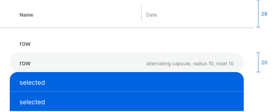

# Sidebar, tables, outline and collection views

IDs: CT-SB-01, CT-TB-01…05. The best-measured instances are in the file manager (MU-10, MU-11,
MU-20, MU-21, MU-25, MU-98); the colours below are the base appearance. The file manager spec also
lists the Reduce Transparency and Increase Contrast variants.

## Sidebar / source list (CT-SB-01)

| Measure | Value |
| --- | --- |
| Extent | full window height, flush with the window's left edges and corners |
| Default width | 192 pt; minimum 135; content keeps at least 316 |
| Width snap | releasing between 191 and 209 snaps to 200 |
| Row pitch | 32 pt |
| Header → first row / last row → next header | 24 / 40 pt |
| Icon | box 16–19 × 14–17, centre at x ≈ 29 |
| Tag dot | 13 × 13, centre at x 29 |
| Text | from x 47, regular, ~14 pt |
| Section header | from x 17, semibold, ~11–12 pt |
| Scroller | 5 pt wide near the right edge |
| Border with the content | none: only the change of tone |

| Colour | Light | Dark |
| --- | --- | --- |
| Background, active (a material: depends on what is behind) | `#ececed` | `#2a2a2c` |
| Background, inactive | `#f2f2f2` | `#29292a` |
| Text / inactive text | `#000000` / `#727272` | `#ffffff` / `#969696` |
| Headers, active / inactive | `#808182` / `#a6a6a6` | `#7c7d7e` / `#5c5c5d` |
| Accent icons (sRGB) | `#0070eb` | `#00abff` |
| Gray icons | `#7c7c82` at rest, `#6e6e74` on the selection | `#b6b7bd` / `#c7c7cd` |
| Icons and dots, inactive window | `#7f7f7f` | `#929293` |

**Selection**

- A rounded rectangle, radius ~8, the full 32 pt row, starting 10 pt from the window edge.
- Selected text turns **semibold**; the icon keeps its colour.
- Active: `#d7d7d7` light (about black 10 % over the background), `#464647` dark (about white
  13 %). Inactive: `#e7e7e7` on `#f3f3f3`, `#373738` on `#29292a`; text `#676767` / `#9b9b9c`.
- **No hover** state, and **no keyboard focus**: the sidebar is never part of the Tab cycle.

**Sections**

- Hovering a header shows a 10 × 6 chevron at its right end, immediately (no fade).
- Clicking it flips the chevron at once (no rotation) and collapses the section: the rows lose
  their text at once, slide up clipped by the header, and the sections below rise with them.
  Collapse starts ~70 ms after the click and lasts ~190 ms; expansion starts ~120 ms after and
  lasts ~190 ms; both decelerate.

**Hiding the sidebar** slides it out to the left in ~240 ms (S curve); showing it takes ~230 ms.
Dragging the edge below the minimum keeps 135 until the pointer is within ~65 pt of the window's
left edge, then the sidebar hides.

## Table with column headers (CT-TB-01)

| Measure | Value |
| --- | --- |
| Header | 28 pt; text ~11 pt, the sorted column semibold |
| Line under the header | light 2 px `#e5e5e5`; dark 1 pt `#494949` + 1 pt `#363637` |
| Column separators | 1 × 16, centred, `#e5e5e5` / `#535353` |
| Sort arrow | chevron 7 × 4 (up ascending, down descending), 8 pt from the column's right edge |
| Row | 20 pt; first row 6 pt below the header |
| Alternating rows | capsules (radius 10) on every other row, inset 10 pt from both sides; they continue below the last row and fill an empty table |
| Icon / name | 16 × 16 icon; name at ~13 pt |
| Indent per nesting level | 15 pt |
| Numbers | right-aligned, 6 pt from the edge; text columns left-aligned +6 |
| Minimum column width | ~75 observed |

| Colour | Light | Dark |
| --- | --- | --- |
| Content background | `#ffffff` | `#272728` |
| Header background | `#ffffff` | `#2f2f2f` |
| Alternating rows | `#f4f5f5` | `#313132` |
| Header text, sorted / other | `#4d4d4d` / `#808080` | `#ffffff` / `#ababab` |
| Primary text | `#252525` | `#dfdfe0` |
| Secondary columns | `#7b7b7b` | `#a2a2a2` |
| Selection, active (sRGB) | `#0064e1` | `#0059d1` |
| 1 pt line between selected rows | `#2673e4` | `#2469d5` |
| Text on the active selection, primary / secondary | `#ffffff` / `#bdcef5` | `#ffffff` / `#bbcbf0` |
| Selection, inactive (line between rows) | `#dcdcdc` (`#d1d1d1`) | `#464646` (`#424242`) |
| Text on the inactive selection | `#222222` / `#6e6e6e` | `#e3e3e3` / `#acacac` |

**Behaviour**

- Several contiguous selected rows form **one block** with rounded outer corners (radius ~8–9),
  square inner corners and a 1 pt line between rows; a single selected row is a 20 pt capsule.
  Both are inset like the alternating rows.
- Right-clicking an unselected row leaves the selection unchanged and draws a **2 pt accent ring**
  inside that row's capsule.
- Header: no hover change; pressing tints the whole cell (separator to separator) `#f2f2f2` /
  `#414141`. Sorting happens on release of a short click (about 130 ms after); a long press that
  is then released does not sort. A new column sorts names ascending and dates and sizes
  descending; a second click reverses.
- Column edges: a 5 pt drag zone (3 pt left of the line, 1 pt right), full header height; no guide
  line while dragging. Dragging a header reorders the columns.
- Rows and triangles show nothing while pressed; selection happens about 19 ms after the release.
- An empty table still shows the header and the alternating rows, with no message.
- Long names are truncated in the middle.

## Outline view (CT-TB-02)

- The disclosure chevron flips in one frame. Children slide out from under their parent while
  the rows below move down: opening starts ~100 ms after the click and lasts ~200 ms, closing
  starts ~74 ms after and lasts ~190 ms.
- Option-click opens or closes the whole subtree; → and ← open and close.
- Without keyboard focus, a selection in an outline or inset table is a gray rounded rectangle.

## Inset table (gallery)

The inset style uses legacy (always visible) scrollers and draws the selected row as a gray rounded
rectangle inset from the edges. With keyboard focus, a 3 pt focus ring surrounds the scroll view.

## Collection view (CT-TB-03)

Measured as an icon grid (64 pt icons, 12 pt labels):

- Icon background when selected: a 72 × 72 rounded square (radius ~6), 4 pt around the icon,
  `#e6e6e6` light / `#3c3c3d` dark.
- Name capsule under it, 2 pt below: 17 pt per line (33 for two lines), radius ~5, ~4 pt side
  margin, following the width of each line. Active accent (sRGB `#0064e1` / `#0059d1`) with white
  text; inactive `#dcdcdc` / `#464646`.
- Labels take at most two lines, truncated in the middle.
- The file manager's grid rules (pitch per text size, positions, cleaning up) are in its own spec.

## Grouped inset list (CT-TB-05)

The Settings-style grouped list is **not measured** yet.
