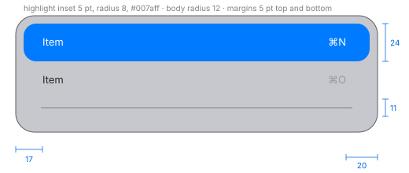

# Menus, pop-up and pull-down buttons, combo box

IDs: CT-MN-01…04, CT-BTN-16…18. Menus opened from the menu bar and context menus share one
look; the measurements below come from menu-bar menus (session 8, M-01) unless noted.

## Menu geometry (CT-MN-01)

| Measure | Value |
| --- | --- |
| Item height | 24 pt |
| Separator row | 11 pt, with a 1 pt line in the middle (5 pt above and below) |
| Inner margin above the first and below the last item | 5 pt |
| Width | from the content: longest label + shortcut + margins |
| Text start, no icons in the menu | 17 pt from the left edge |
| Text start, menu with icons | icon at 16–17 pt (12–14 pt wide), text at 38 pt |
| Checkmark + icon menu | checkmark at 12–20 pt, icon at 29–40, text at 49–50 |
| Shortcut / submenu arrow | last glyph ends 19–20 pt from the right edge |
| Baseline | 17 pt below the top of the item (text centred on the item) |
| Text size | ~13 pt (cap height 9.3 pt) |
| Section header (gray, not selectable) | ~11 pt, slightly bolder |
| Separator line extent | 16 pt margin at each side |
| Submenu arrow | chevron 6 × 9, vertically centred |
| Checkmark | about 9 × 9, the colour of the item text |
| App icons in a submenu | 14 × 14, in colour, 16 pt from the left edge, 9 pt before the text |

- **Placement under the bar:** the body's left edge sits 5 pt to the left of the item that opened
  it; the top edge is 1 pt below the bar.
- **Alternate items** (shown while a modifier key is held) take the same row as the main item:
  they replace it, they are not extra rows.

## Border, radius, shadow

- Corner radius about 12 pt (±1) measured on the outer hairline; the body is ~11.
- A 1 pt **outer hairline** just outside the body and a 1 pt **inner edge light** just inside:

  | | Light | Dark |
  | --- | --- | --- |
  | Outer hairline over `#7a7b80` | `#5d5d61` (black ~24 %) | `#111112` (black ~86 %) |
  | Inner edge light, top | `#f2f2f4` | `#86888b` |
  | Inner edge light, sides | `#cdced2` | `#818286` |
  | Inner edge light, bottom | `#dedfe4` | `#96979d` |

  The edge light is strongest at the top and bottom, weakest at the sides.
- **Shadow** over `#7a7b80`: at the side the first pixel outside is 11 % darker (light) / 14 %
  (dark), fading over ~16–17 pt; below it is 16 % / 20 % darker and fades over ~20 pt. The shadow
  is offset downward by a few points (about 4).

## Fill and text

- The fill is the menu glass ([materials.md](materials.md)): over `#7a7b80` it reads `#c7c8cd`
  light, `#6f7075` dark, slightly darker near the sides (a ~15 pt horizontal vignette) and with a
  cool tint (blue 5 levels above red).
- Text is translucent black or white, not a fixed gray:

  | State | Light | Dark |
  | --- | --- | --- |
  | Enabled item | black 85 % (`#232323`–`#262626` over the fill) | white 85 % |
  | Disabled item | black ~26 % (`#b8b9b9`) | white ~26 % (`#716e6f`) |
  | Shortcut glyphs | black 26–35 % | white ~30 % |
  | Section header | black ~26 % (`#969696`) | — |
  | On the highlight | white `#ffffff` | white |

- Separators: light black ~10 % over the fill, dark white ~14 %.

## Highlight

- A flat accent rectangle (sRGB `#007aff`), the same in light and dark, no border or shadow.
- Inset 5 pt from the left and right edges of the body, 24 pt tall (the full item); consecutive
  items touch, with no gap.
- Radius about 8 pt (±1).
- Text inside it starts 12 pt from the highlight's left edge; the shortcut ends 15 pt from its
  right edge.

## Submenus

- A submenu's first item sits at the same height as its parent item, so the submenu's top edge is
  5 pt above the parent item.
- Its left edge is 5 pt inside the parent menu, exactly at the right edge of the parent's highlight:
  the two menus overlap by 5 pt, the submenu is drawn above and casts its shadow on the parent.
- Same radius, border and material as the parent.

## Behaviour (menus opened from a bar)

| Action | Result |
| --- | --- |
| Press on a bar item | the menu opens on press, in a single frame, about 120–160 ms later; no opening animation |
| Release right after the press | the menu stays open |
| Press, drag over items, release on one | the item under the pointer follows the drag; the release chooses it |
| Choosing an item | the highlight blinks once (off in the next frame, on again at ~+74 ms), then the menu fades in ~190 ms |
| Esc | closes with the same ~190 ms fade |
| Pointer moves to another bar item while open | the menu switches in one frame, ~80–90 ms after the pointer enters |
| Pointer rests on an item with a submenu | the submenu opens after ~295 ms, in one frame |
| Pointer moves diagonally toward an open submenu over other items | the submenu stays open (triangle tolerance) |
| Pointer returns to another parent item | the submenu closes at once |
| ↓ with nothing highlighted | highlights the first item; each ↓ moves one item |
| Typing a letter | jumps to the first item starting with it |
| → / ← | move to the next / previous menu in the bar |

The highlight's own fade in and out was not measured.

## Context menus (CT-MN-02)

Same look as bar menus. They open at the pointer. A context menu on an unselected list row leaves
the selection alone and draws a 2 pt accent ring inside that row (see [lists.md](lists.md)).

## Pop-up button and pop-up menu (CT-BTN-16, CT-MN-03)

| Instance | Frame |
| --- | --- |
| Gallery pop-up | 140 × 25 (24 visible) |
| Save panel format menu | 232 × 26 |
| Alarm sound | 224 × 24 |

- A gray capsule (push button fill) with an up/down chevron pair at the right end.
- The menu opens on press. In a pop-up menu the checked item is placed over the button (only its
  structure was observed: *partial*).
- When a toolbar view switcher becomes too narrow it turns into a 48 × 38 pop-up (icon + up/down
  chevrons).

## Pull-down button (CT-BTN-17)

- 120 × 25 (24 visible) in the gallery, with a single down chevron. In toolbars the pull-down is a
  glass capsule (see [toolbar.md](toolbar.md)).
- Opens its menu on press.

## Combo box (CT-BTN-18)

- 140 × 25: a white field (dark `#191919`) with a small gray chevron button at the right.
- The focus ring is 3 pt outside the frame (visible 146 × 30).
- The list opens on press of the chevron. Its look beyond that is *provisional* in silica_ui.

## Menu with a section title (CT-MN-04, partial)

A gray, non-selectable header row inside a menu, as in the section headers above; seen in a
Control Center context menu, not measured separately.
