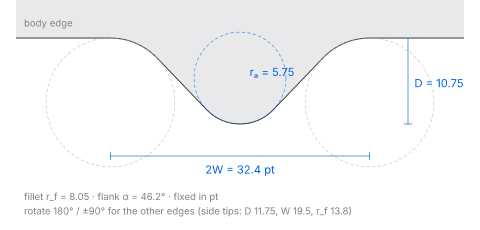

# Popovers and the tip outline

IDs: CT-PO-01…04, TIP-01, MU-62.

## Popover body

| Instance | Body | Radius | Fill (top → bottom) |
| --- | --- | --- | --- |
| Tag popover (file manager toolbar) | 228 × 226 | ~18 | `#f8f8f9` → `#f6f6f7` light, `#474748` → `#505051` dark |
| Gallery popover (all four edges) | 200 × 80 and 420 × 220 content | ~16 | the menu material ([menus.md](menus.md)) |

- A 1 px dark border surrounds the body and the tip.
- Popovers attached to toolbar buttons open **on release** (menus open on press).
- In macOS 27 the status menus and the Control Center hang from the menu bar as plain panels
  with **no tip**: a tip appears only on popovers and on the Dock's menus and labels.
- Transient behaviour (closing on an outside click, on Esc) matches the usual popover behaviour;
  the fade and the gap between the tip and the anchor were not measured. silica_ui fades in
  120 ms and leaves a 1 pt gap (*provisional*).

## Tip outline (TIP-01)

The tip is **not a triangle**. Its outline is: a large concave fillet leaving the body edge, a
short straight flank, a large round apex, then the mirror image. Model (fits within ~0.2 px, the
limit of a 1× capture): two straight flanks meeting the body edge at angle α, an apex circle of
radius rₐ tangent to both flanks, and fillet circles of radius r_f tangent to the body edge and to
each flank.



| Case | Depth D | Half-width W | α | rₐ | r_f | Width at D/2 |
| --- | --- | --- | --- | --- | --- | --- |
| Popover, tip on the top or bottom edge | 10.75 | 16.2 | 46.2° | 5.75 | 8.05 | 15.2 |
| Popover, tip on a side edge | 11.7–11.8 | 19.3–19.6 | 46.0–46.2° | 5.71–5.75 | 13.3–13.8 | 16.2–16.3 |
| Dock icon menu | 10.19 | 15.3 | 50.8° | 5.30 | 9.41 | 13.2 |
| Dock hover label | 6.5 | 9.4 | 39° | 0.9 | 3.0 | — |

- D is measured from the body edge to the apex; W is where the outline leaves the body edge.
- **Fixed in points:** a 420 × 220 popover has the same tip as a 200 × 80 one (within 0.2 px).
- Side tips are about 1 pt deeper with longer fillets; the flank angle and the apex radius are the
  same as on top and bottom edges.
- Left and right halves are symmetric within 0.2 px. On the Dock menu the tip sits 27 pt from the
  menu's left edge, so its left fillet runs into the body's corner (radius ~12).
- Dark appearance: the same geometry within ~0.3 px.

**Paths** (origin at the apex, tip pointing down, body edge at y = −D; rotate by 180° or ±90° for
the other edges):

```
Popover, top/bottom edge:
M-16.193,-10.745 A8.053,8.053 0 0 1 -10.382,-8.267 L-4.147,-1.768
A5.747,5.747 0 0 0 4.147,-1.768 L10.382,-8.267 A8.053,8.053 0 0 1 16.193,-10.745 Z

Popover, side edge:
M-19.619,-11.752 A13.830,13.830 0 0 1 -9.633,-7.490 L-4.155,-1.773
A5.755,5.755 0 0 0 4.155,-1.773 L9.633,-7.490 A13.830,13.830 0 0 1 19.619,-11.752 Z

Dock menu:
M-15.289,-10.187 A9.414,9.414 0 0 1 -7.992,-6.720 L-4.105,-1.950
A5.295,5.295 0 0 0 4.105,-1.950 L7.992,-6.720 A9.414,9.414 0 0 1 15.289,-10.187 Z

Dock label:
M-9.361,-6.516 A3,3 0 0 1 -7.461,-5.838 L-0.583,-0.208
A0.92,0.92 0 0 0 0.583,-0.208 L7.461,-5.838 A3,3 0 0 1 9.361,-6.516 Z
```

**Rim and shadow around the tip**

- The inner edge light follows the tip but thins toward the apex (on black: `#aaabaa` at a straight
  edge, `#969696` at the apex, over a `#858585` fill).
- The 1 px outer dark line follows the whole outline (on white `#9b9b9b` at a straight edge,
  `#cacaca`/`#c1c1c1` over 2 px at the apex; much stronger in dark).
- The shadow around the apex is lighter than under a straight edge: on white `#e5e5e5` → `#f4f4f4`
  over 7 px at the apex, `#d6d6d7` → `#ededed` over 8 px under the edge.

## Popover with the tip above the anchor (CT-PO-02, partial)

A calculator first-launch tip and a window-button popover: structure only.

## Popover with a list (CT-PO-04, partial)

A sharing popover from a toolbar button opens on release; its content was not measured.
