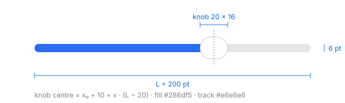

# Sliders and steppers

IDs: CT-SL-01…07.

## Linear slider (CT-SL-01, 02, 03)

| Instance | Frame | Track | Knob |
| --- | --- | --- | --- |
| Gallery, regular | 200 × 24 | 6 pt | horizontal capsule 20 × 16 |
| Gallery, small | 160 × 20 | thinner | smaller |
| Control Center detail | 231 × 16 | 6 pt | capsule 20 × 16, `#e8e9ea` |
| Control Center main tile | 181 × 14 | 4 pt (radius 2) | **none visible** |
| File manager status bar | 80 × 4 track | 4 pt | 18 × 14 |

- **Colours (gallery):** fill accent (display `#286df5` light, `#2e73fb` dark); rest of the track
  `#e6e6e6` light, `#3c3c3d` dark; knob white (dark `#dfdfdf`) with a shadow in light.
- **On glass (Control Center):** fill white, rest of the track `#7a7b80` over the `#68696e` tile in
  the detail panel, `#7e7f84` in the main tile. A glass ring lightens the track border just left of
  the knob, and the knob casts a short shadow on the right.
- **Fill end:** the fill reaches the **centre of the knob**. With value v, track start x₀ and length
  L, the knob centre is at `x₀ + 10 + v · (L − 20)` (the 20 pt knob never leaves the track). In the
  main Control Center tile the fill ends at the same point, as if the knob were there but
  invisible.
- **Disabled** (a brightness slider for an external display): only the track, `#86878c`–`#88898e`,
  no fill and no knob.
- **Vertical slider:** 24 × 110, the linear slider rotated.
- In an inactive window the fill turns gray (`#c5c5c5` / `#585859`).

## Slider with tick marks (CT-SL-04)

200 × 30: the same track with 11 tick dots below. silica_ui draws 3 pt dots, 3 pt below the knob
(the dot size is *provisional*).

## Circular slider (CT-SL-05)

32 × 32 frame, 24 × 24 visible: a gray disc with a dark dot as the indicator.

## Timer wheel (CT-SL-06, partial)

Hour / minute / second wheels (accessibility frames 119 × 86 each); no colours measured. Not in
silica_ui.

## Stepper (CT-SL-07, partial)

- 20 × 24: a gray rounded pill with up and down chevrons.
- The pressed halves were not captured. silica_ui draws it 20 × 24 as a pill (radius 10) and
  repeats after 400 ms, then every 80 ms, while held (the radius and the timing are
  *provisional*).

