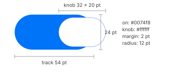

# Switches, checkboxes and radio buttons

IDs: CT-SW-01…03, CT-CB-01, CT-CB-02, CT-RB-01. State rules in
[focus-and-accent.md](focus-and-accent.md).

## Switch (CT-SW-01, 02, 03)

| Size | Visible track | Where seen |
| --- | --- | --- |
| Large | 64 × 28 | gallery |
| Regular | 54 × 24 | gallery; Control Center detail panels |
| Small | 44 × 20 | gallery |
| Mini | 36 × 16 | gallery; Settings rows (right edge of the row) |
| App card | 68 × 30 | alarm cards (orange app tint) |

- **Track:** a full capsule. On = accent (display `#286df5` light, `#2e73fb` dark; the Control
  Center switch measures sRGB `#0074f8`, radius 12 on the 54 × 24 track). Off = light gray
  (about `#e2e2e2`) in light.
- **Knob:** white, itself a capsule: 32 × 20 inside the 54 × 24 track, leaving 2 pt above, below
  and at the end. In light it has a soft shadow; in dark there is none. In a Settings row the
  36 × 16 track carries a 21 pt knob.
- **Pressed:** the knob stretches into a wider glass capsule while the button is held.
- **Dark off state** (app card): track `#454545`, knob `#e3e3e3`.
- **Inactive window:** the on track turns gray. **Disabled:** the accent stays, at reduced
  opacity.
- **"Show borders"** accessibility setting: only the on switch changes, gaining a darker accent
  outline.
- The knob animation was not measured; silica_ui uses 200 ms ease-out (*provisional*).

## Checkbox (CT-CB-01, 02)

| Size | Box |
| --- | --- |
| Regular | 16 pt |
| Small | 14 pt |
| Mini | 12 pt |

- Rounded square, radius about 4 pt at 16 pt.
- Off: `#e6e6e6` light, `#3c3c3d` dark. Pressed: `#cfcfcf` / `#4f4f50`.
- On: accent fill with a white check. Mixed: accent fill with a white dash.
- No hover. Disabled and inactive follow the shared rules. The keyboard focus ring was not
  captured.
- silica_ui scales the corner radius as 0.28 × side (*provisional* for 12 and 14 pt).

## Radio button (CT-RB-01)

- A 16 pt circle. Off: `#e6e6e6` (dark `#3c3c3d`). On: accent with a white centre dot.
- Pressed, disabled and inactive follow the shared rules.
- The dot diameter was not measured separately; silica_ui uses 0.43 × the circle (*provisional*).
- In a group the arrow keys move the choice (silica_ui behaviour, not measured).
