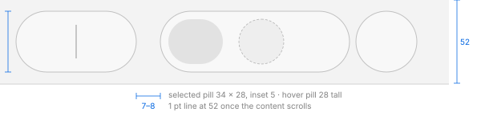

# Window toolbar and the veil over scrolling content

IDs: CT-TL-01, CT-TL-03, CT-BTN-11, CT-BTN-12, CT-SEG-01, MU-02, MU-07, MU-98, MU-99, R1.9.

## Geometry (CT-TL-01)



| Measure | Value |
| --- | --- |
| Band height | 52 pt from the window top (66 with labels under the items) |
| Capsules | 38 pt tall, 7 pt from the top and bottom of the band, full radius (19); a lone search button is a 38 pt circle |
| Gap between capsules | 7–8 pt |
| Separator inside a capsule (back / forward) | 1 × 21, `#c7c7c7` light, `#7a7a7a` dark |
| Selected segment pill | 34 × 28, inset 5, radius 14; `#e2e2e2` → `#e7e7e7` light, `#595959` dark |
| Icon stroke | ~1.5 pt |
| Icon colour | `#000000` light, ~`#e9e9e9` dark; disabled `#ababab` light |
| Title | semibold, ~15 pt; `#4d4d4d` light, `#e9e9e9` dark; inactive `#bebebe` / `#646464` |
| Title minimum width | 160 pt (below it the title is truncated and items start to move to the overflow menu) |
| Keyboard focus ring | 4 pt, 1 pt inside the control, following the segment shape (colours in [focus-and-accent.md](focus-and-accent.md)) |

**Capsule fill** (top → bottom; outline top / bottom / sides):

| | Light | Dark |
| --- | --- | --- |
| Background | `#f6f6f6` → `#fdfdfd` | `#4c4c4c` → `#535454` |
| Outline | `#ebebeb` / `#e8e7e8` / `#c1c1c1` | `#79797b` / `#6c6e6e` / `#131313` |

The file manager spec also gives the Reduce Transparency and Increase Contrast capsules.

## Control states (CT-BTN-11, CT-SEG-01)

Colours at the centre of the pill, outside the glyph:

| State | Light active | Dark active | Light inactive | Dark inactive |
| --- | --- | --- | --- | --- |
| Rest: capsule / glyph | `#f8f8f8` / `#000000` | `#434344` / `#ffffff` | `#f0f0f0` / `#a4a4a4` | `#424243` / `#757576` |
| Hover pill (glyph) | `#eeeeee` | `#5e5e5f` | `#e6e6e6` (glyph `#000000`) | `#565657` (glyph `#ffffff`) |
| Pressed pill / glyph | `#e8e8e8` / `#232323` | `#737374` / `#f8f8f8` | as active | `#6d6d6e` |
| Selected segment: rest / hover / pressed | `#e5e5e5` / `#dbdbdb` / `#d2d2d2` | `#575758` / `#727273` / `#757576` | `#dcdcdc` / `#d2d2d2` / — | `#565657` / `#6a6a6b` / — |
| Disabled | no hover pill | no pill; a faint one when pressed | — | — |

- **Hover pill:** 28 pt tall, 5 pt inside the 38 pt capsule, about 3 pt narrower than its segment
  (a button with its own capsule: the capsule minus 2 pt). It appears and disappears in one frame.
  The separators next to the hovered segment hide.
- **Press:** the pill darkens (light −16 levels, dark +48) and the **whole capsule grows by 1 pt on
  each side**, in the first frame, without a fade.
- In dark, with the pointer anywhere in the band, the band lightens (`#272828` → `#2e3030`) and the
  capsules lift by about 7 levels.
- **Inactive window:** the pointer over a control relights it (pill and full-strength glyph); a
  click activates the window and performs the action.
- **Timing:** a back click navigates ~96 ms after the release; a view change happens ~100 ms after
  the release and the selected pill jumps (no sliding). Holding back or forward for ~0.3 s opens the
  history menu; releasing over the button then closes the menu without navigating.
- Menu buttons (group, action, overflow, view switcher) open on **press**; share and tag buttons
  open their popovers on **release**; the search button opens the field on release.

## Narrowing (MU-02)

As the window narrows, items leave from the right (the search button always stays) and move into an
**overflow menu** behind a 38 pt glass circle placed before search. The view switcher first becomes a
48 × 38 pop-up. The overflow menu opens to the right of its button, text-only items in bar order,
139 pt wide, 24 pt items.

## Background

- **No content under the band:** the band has no background of its own in an active window (the
  content colour shows). In an inactive window, dark uses `#2f2f30`–`#2e2e2e` and a 1 pt line sits
  at y 52 (`#e5e5e5` light, `#363636` dark).
- **Content scrolled under the band (R1.9):** see the veil below; it is identical in active and
  inactive windows.

## The veil over scrolling content (CT-TL-03, R1.9)

The content keeps scrolling under the toolbar band and stays visible, blurred and covered by a
**uniform** veil from y 1 to y 51 (no vertical gradient; the top row is 1 px lighter).

**Colour formula** (error ≤ 0.7 levels over five test colours), with L the Rec. 709 luminance of
the content, result clipped to 255:

```
out = offset + scale · (L + s · (in − L))
```

| | offset | scale | s | Reads as | Examples |
| --- | --- | --- | --- | --- | --- |
| Light | 135.3 | 0.486 | 1.24 | white at ~51 % plus saturation × 1.24 | black → `#888888`, red (display `#f13710`) → `#ff9e86` |
| Dark | 31.1 | 0.400 | 1.25 | `#333333` at ~60 % plus saturation × 1.25 | white → `#858585`, black → `#1f1f20` |

**Blur:** two Gaussians of about equal weight: light σ 4.2 pt (weight 0.46) plus σ 36.1 pt
(0.54); dark σ 3.2 (0.52) plus σ 33.7 (0.48). A single Gaussian triples the error. The result has a
steep step over ~6 pt with long tails.

**Line at the band's bottom edge:** none while the content is at the top; as soon as the content
scrolls, a 1 pt line across the content width: light × 0.9 (white → `#e5e5e5`), dark + 7 % white
(black → `#121212`).

**Bars under the toolbar:** a column header, a tab bar or a search scope bar join the same veiled
band (for a list: one band 0–79 with the header's own line at 80; with tabs, a separator at the top
of the tab bar and the line under the last bar).

**Capsules over content** show the colours below refracted at their edges. silica_ui approximates
this with a blurred translucent rim (3 pt wide, σ 3, fill alpha 0.45, outline alpha 0.6;
*provisional*: no refraction yet).

**Inactive window with content scrolled:** the veil is the same; whether the always-present inactive
line also shows with content at the top is still to verify. silica_ui keeps the line in an inactive
window (*provisional*).
